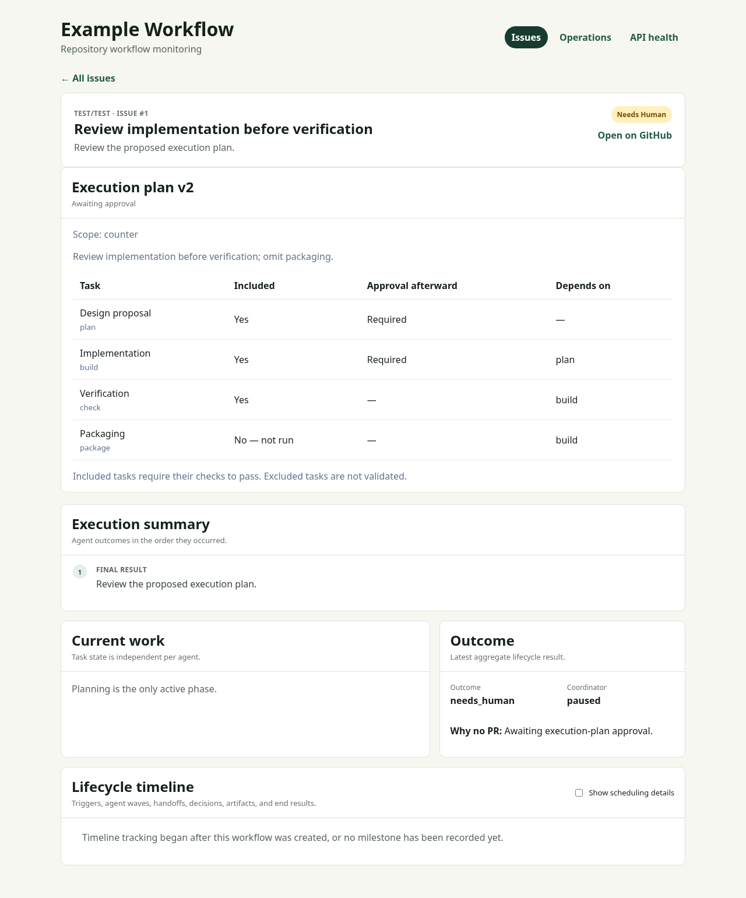

# Approved execution plans

Lifecycle plugins can opt into versioned, human-approved scheduling choices:

```yaml
flows:
  change:
    start: plan
    execution_plan:
      optional_tasks: [package]
    # tasks, roles, and dependencies follow the existing plugin interface
```

Only named optional tasks may be excluded. The start task cannot be excluded,
and an included task cannot depend on an excluded task. Plans can add human
approval after tasks, but cannot remove approval required by the manifest.
Existing plugins without this setting retain their current behavior.

The planning task receives `available_tasks`, `execution_plan_policy`, and the
retained `execution_plan` in run input. Its result may include:

```json
{
  "execution_plan": {
    "excluded_tasks": ["package"],
    "approval_tasks": ["build"],
    "reason": "The requester wants to review implementation before validation."
  }
}
```

This field extends the existing task result; all other result requirements still
apply. Only the start task may propose it. Plugins interpret natural-language
preferences in the issue; Donkeyspace validates and enforces the structured
result. Without a proposal, the default includes every task and retains existing
approval gates. The default still requires approval before downstream work.

The proposal comment includes a table of task inclusion, dependencies, and review
gates. The normal start-task approval accepts both the specification and the
displayed plan. The resolved plan, revision, selected work items, and acceptance
are stored in the coordinator checkpoint. Retries retain that plan. Changing the
configured task dependencies or approval defaults cannot silently change its meaning.

When a task has a review gate, its successful output is published and downstream
tasks wait. `revise TASK/ITEM` reruns it with feedback and requests approval again;
`approve TASK/ITEM` releases its dependents. Excluded tasks are never marked passed
and cannot be restarted by an automatic handoff. Such a handoff requests human
input instead. Final summaries retain the included/excluded stage table.

## Change only the execution settings

On a paused or failed parent issue with a retained lifecycle checkpoint, an
authorized approver can submit a new plan without rerunning specification work:

```text
/donkeyspace revise execution-plan
excluded_tasks: [package]
approval_tasks: [build]
reason: Review implementation before validation; omit packaging for this run.
```

Use the installation's command prefix and manifest task names. This command
accepts YAML (or JSON), not free-form prose. Both lists describe the complete
desired settings; omitted lists are empty. Unsupported tasks and broken
dependencies are rejected. The resulting plan requires its own explicit command:

```text
/donkeyspace approve execution-plan
```

The existing specification approval is retained. Newly requested review gates
also apply to completed artifacts before downstream work resumes. Other pending
approvals remain pending. Approving the plan does not approve those artifacts.
Plan revisions while work is running are not supported; wait for a pause or
failure. For a new managed PR revision, use its normal task revision commands.

Failed issue revisions resume the same coordinator only when its incomplete
checkpoint includes immutable repository provenance. Authorized targeted task
revision is also available after failure for retained plugin lifecycles. Commands
use the human-approval engagement rule, and duplicate comments cannot reapply them.
A missing or completed checkpoint does not start a fresh workflow implicitly.

## Upgrade and validation

Upgrade API and worker together. Checkpoint version 6 carries the execution plan;
version 5 remains readable and is upgraded on save. Enabling plans for an older
run without one requires plan approval before further downstream execution.
Do not downgrade a worker against version 6 checkpoints.

No database migration is needed: plans use the existing checkpoint JSON and
approval/event records. Current required validators and publication checks remain
in force. Excluding a task changes the approved execution scope, not the meaning
of a successful check or the underlying design contract.

`scripts/test-database` includes the container-backed implementation/revision/
approval sequence and failed-checkpoint ingress, with duplicate and authorization
checks. Core tests cover full defaults, valid omissions, dependency rejection,
and changes to the configured flow.

The dashboard exposes the same structured plan and approval state:


